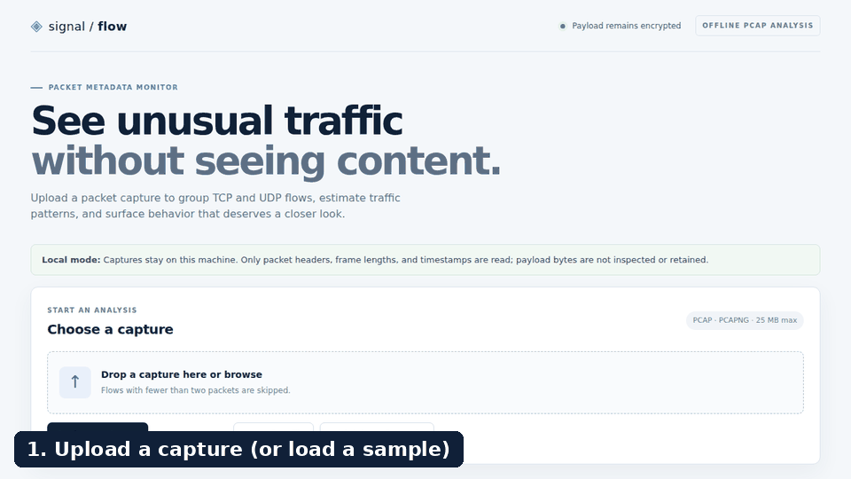
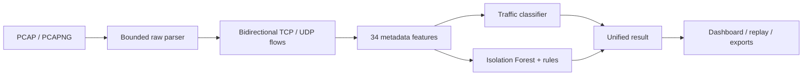

# Signal / Flow — see unusual traffic without seeing content

Offline analysis of encrypted network captures using **packet metadata only** (sizes, directions, ports, timing). It groups TCP/UDP flows, flags suspicious behavior with plain-language reasons, and shows everything in an interactive dashboard. Payloads are never read.

**Live demo:** https://signal-flow-ixlb.onrender.com/ — click **With injected attacks**. (Free hosting: the first load can take up to a minute. The demo is public, so use only the bundled samples.)



**Results at a glance (real captures, with their limits)**

- **Botnet:** on a public CTU-13 "Neris" capture, the detector flagged the infected host and 99.8% of its 5,230 flows. The fixed rules did the work; the learned model alone flagged none of them. One botnet, one host.
- **Normal traffic:** on two held-out slices of a separate busy-use recording (378 flows), 5 alerts (1.3%), all from the large-upload rule. Same network as the training data, so this says nothing about other networks.
- **Classifier:** a prototype. Its 62.7% comes from a random flow split that may leak, so it is not real-world accuracy. The bundled sample captures are synthetic and demonstrate anomaly detection, not classification.

Built with Python, Scapy, scikit-learn (Isolation Forest and Random Forest) and Flask, with 41 tests. Run it locally with the steps below; full results and caveats are in the results sections further down.

## Try it locally

Requires Python 3.11 or 3.12. In the VS Code terminal, run these two commands:

```powershell
python -m pip install -e .
python src/app.py
```

Open `http://127.0.0.1:5000`. Use **With injected attacks** to inspect the sample findings, or load a capture through the upload area. The demo accepts `.pcap`, `.pcapng`, and `.cap` files up to 25 MB.

For an isolated Python environment on Windows:

```powershell
py -3.11 -m venv .venv
.\.venv\Scripts\Activate.ps1
python -m pip install -e ".[dev]"
python src/app.py
```

You can use the shareable local demo URL `http://127.0.0.1:5000/?sample=with_attacks.pcap` to load the safe bundled attack capture automatically.

## What it does

- **Anomaly monitor:** configurable rules (the main detector) plus an Isolation Forest trained on benign flows as a secondary outlier signal. The rules cover for port scans, slow scans, upload-heavy exfiltration patterns, high-rate bursts, beacon-like timing, and large UDP/53 flows.
- **Score and explanation:** Each flow receives a 0–100 score, low/medium/high severity, rule hits, statistical reasons, and z-score context.
- **Traffic classifier:** Predicts browsing, download, gaming, streaming, or video-call-like traffic. Flows under 6 packets (scan probes, lone DNS lookups) are labeled “too short to classify” and left out of the traffic mix, and low-confidence flows are marked “needs review.” These are traffic-shape estimates, not app identification.
- **Dashboard:** Summary cards, sortable/searchable alerts, severity filters, class/score/timeline charts, flow detail with packet-size/timing trace, replay controls, acknowledgement/dismissal and local notes.
- **Exports:** CSV alerts, JSON analysis, and a printable one-page HTML incident summary. Browser review state is included only when an export is requested.
- **Input protection:** 25 MB file limit, 100,000 packet cap, 25,000 flow cap, upload rate limit, supported file extension check, friendly malformed-capture errors, same-origin CORS by default, and no hardcoded secret.
- **Integrity check:** The app verifies model SHA-256 values in `models/manifest.json` before loading joblib artifacts.

## Architecture



See [`docs/architecture.md`](docs/architecture.md) for data flow and privacy controls, and [`docs/detectors.md`](docs/detectors.md) for every detector and its default threshold.

## Sample captures and truth labels

The repository includes:

- [`sample_data/normal.pcap`](sample_data/normal.pcap): 500 synthetic normal flows across the five classifier classes.
- [`sample_data/with_attacks.pcap`](sample_data/with_attacks.pcap): 80 synthetic normal flows plus 62 injected attack flows.
- [`sample_data/normal_labels.json`](sample_data/normal_labels.json) and [`sample_data/with_attacks_labels.json`](sample_data/with_attacks_labels.json): separate per-flow ground truth including attack type and synthetic session ID.

The generator uses documentation-only IP ranges and zero-filled synthetic payload bytes. Regenerate the fixtures and re-run the synthetic evaluation with the commands below. **Do not run `python scripts/train_anomaly.py` unless you want to replace the shipped model with one trained on the synthetic sample;** to retrain on your own benign captures use `python scripts/train_anomaly_from_pcaps.py <benign.pcap>` (previous model is kept in `models/previous_anomaly/`, restore with `--restore`).

```powershell
python scripts/generate_samples.py
python scripts/evaluate_anomaly.py
```

## Measured anomaly results

On the bundled synthetic test set, the current model found **62/62 attack flows** at score ≥60 (100% recall), with 100% precision, 0% false-positive rate in the mixed attack capture, ROC AUC 1.000, and PR AUC 1.000. Per attack type, the synthetic fixtures were detected as follows:

| Attack pattern | Test flows | High severity found | Matching rule |
| --- | ---: | ---: | ---: |
| Port scan | 26 | 26 (100%) | 26 (100%) |
| Slow scan | 32 | 32 (100%) | 32 (100%) |
| Exfiltration shape | 1 | 1 (100%) | 1 (100%) |
| High-rate burst | 1 | 1 (100%) | 1 (100%) |
| Beacon-like flow | 1 | 1 (100%) | 1 (100%) |
| Large UDP/53 flow | 1 | 1 (100%) | 1 (100%) |

The separate 500-flow synthetic normal capture produced no medium-or-higher alerts (0.0%) with the shipped model, which is now trained on a real benign capture rather than this sample. Curves, confusion matrix, per-attack results, and full methodology are in [`reports/anomaly_evaluation.md`](reports/anomaly_evaluation.md).

### External checks on real public/recorded captures

The shipped anomaly model is trained on 1,355 flows of recorded benign traffic: `traffic.pcap` (901 flows) plus three chunks of a second, long capture on another network (283, 98 and 73 flows, mostly large UDP/QUIC streams). The model was retrained in three steps, and the earlier rows below were measured with earlier versions, as noted. Alert = medium or high severity. All results come from one person's traffic on two networks and are a first external check, not a benchmark.

| Test capture | Result |
| --- | --- |
| Original synthetic-trained model, benign browsing capture (65 flows) | 100% false alarms; it also alerted on every attack flow, so it could not tell them apart |
| Browsing capture (65 flows), by retrain step | 4.6% (traffic.pcap only), 3.1% (plus 178 flows of the second capture), **0.0%** (current model, 0 of 65) |
| Busy benign capture (836 flows) | 0 fixed-rule alerts; 0.2% model alerts (it was in the training data, so optimistic) |
| CTU-13 Neris botnet slice (5,230 flows, 100,000 packets) | 99.8% of attack flows alerted, all by the scan and exfiltration rules; the model alone flagged none |
| Mixed capture: 43 benign flows + 2,748 Neris attack flows | Current model: 99.7% recall (2,740 of 2,748), 0 of 43 benign flows alerted; precision 100.0% is inflated by the 64:1 attack-to-benign ratio, and the 43 flows are a subset of the browsing capture |
| Benign busy session, two slices of a separate recording on the same hotspot (not in training) | **5 of 378 flows alerted (1.3%, 95% interval about 0.5-3.0%)**, all from the large-upload rule (big uploads such as cloud sync or calls, flagged for review); the anomaly model alone flagged none. Same network as the training data, so not evidence for other networks |
| Held-out end of the second capture (31 flows, current model) | 6.5% (2 flows), both from the `exfiltration` rule rather than the model; the previous model also had 1 model-only alert (9.7%) |

What this shows: the fixed rules detect scan-like behavior and stayed quiet on normal browsing and streaming, except for the two held-out flows above. Retraining on more varied benign traffic removed the anomaly model's false alarms on the independent browsing capture, but the model has **not** been shown to catch any attack the rules miss. The Neris capture is one infected host scanning many ports, and the benign samples are small, so false-alarm rates carry wide margins of error.

**Known limits found in testing.**
- *Capture started mid-connection.* The tool treats the first packet it sees in a flow as the client. If a capture begins in the middle of a large download, the direction can flip and the download looks like an upload. The two held-out alerts above (one 47 MB UDP flow, one 168 KB TCP flow) are most likely this. Start captures before the activity, or review upload-heavy alerts in context.
- *Large-packet floods.* `dos_burst` only fires on flows averaging 600 bytes per packet or less, so a flood of large UDP packets would not trigger that rule.
- *Unseen traffic types.* The model flags flows unlike its training data, so it needs refitting on each network's normal traffic.

**The bundled synthetic attacks are intentionally clear and easier to detect than real intrusions.** The test captures were generated by this repository, are not independent network traffic, and do not measure evasive or distributed activity. The external results above are the only real-traffic checks. The synthetic metrics are not a production detection guarantee.

## Classifier evaluation and limitations

The historical captured-flow dataset has 1,554 flows. Its recorded Random Forest result is **62.7% accuracy and 0.632 macro F1** from a stratified random flow split. Those rows have no session IDs, so correlated flows may cross train/test; this score is not an estimate of performance on an independent capture.

`src/capture.py` now records a unique session ID per capture run. `src/train.py` will hold out whole identified sessions when there are enough separate sessions with all classes represented; historical rows without IDs are excluded from that grouped evaluation. Until new real sessions are collected, the prior random-split score remains the only real-capture classifier baseline. The generated session-held-out experiment in [`reports/classifier_synthetic_session_evaluation.md`](reports/classifier_synthetic_session_evaluation.md) tests Random Forest, class-weighted gradient boosting, probability calibration, feature importance, and a review threshold, but synthetic class signatures are too easy to justify changing the serving classifier.

**The bundled sample captures are synthetic and do not look like the real traffic the serving classifier was trained on.** Comparing its predictions with `sample_data/normal_labels.json`, top-class accuracy on the 500-flow sample is about 56%: gaming and streaming flows are mostly predicted as downloads, and about 92% of flows are low-confidence. The dashboard now warns when more than half of a capture's flows are low-confidence, so the traffic mix is not presented as reliable. Use the bundled samples to demonstrate anomaly detection, not classification.

Step-by-step help, including public datasets and how to test the anomaly detector on traffic this project did not generate, is in `docs/real-data-guide.md`.

### Improve the classifier with real captures

1. Record several separate captures per class with tcpdump, Wireshark, or dumpcap, doing only that activity, and save them as `captures/<label>/<session>.pcap` (labels: `browsing`, `streaming`, `video_call`, `download`, `gaming`; at least 4 sessions per class).
2. `python scripts/build_dataset_from_pcaps.py captures/ --append` (or `make dataset CAPTURES=captures`) adds the sessions to `data/features.csv`, one session ID per file. Without `--append` the script refuses to overwrite the existing file.
3. `python src/train.py` then holds out whole sessions and writes `reports/evaluation.md`. Copy that real score into this README, even if it is lower than the current 62.7%.
4. Optionally add one short real capture as the demo sample so the hosted traffic mix is meaningful.

Quick experiments on the 1,554 real flows (5-fold random split, so optimistic and only useful for comparing options): gradient boosting scored 63.6% against 63.2% for the Random Forest, and keeping only larger flows (10+ or 20+ packets, or 5 KB+) did not improve accuracy (61–62%). Neither change is worth adopting; the limit is more likely the data (flows labeled by the session they were recorded in, with no independent sessions), which is why the real-capture steps above matter more than model tuning.

Other limits: encrypted metadata cannot prove the application, user, or intent; packet loss and capture direction affect features; the scan rules depend on source grouping and fixed thresholds; benign backups, checks, DNS, keep-alives, and media bursts may look unusual. Use alerts to focus review, not as proof of compromise.

## Project layout

```text
src/         parser, features, classifier, anomaly engine, Flask API and app
scripts/     sample generator, model training and evaluation commands
tests/       parser, flow, feature, detector, hash and API tests
docs/        architecture, detector, deployment notes
sample_data/ sanitized synthetic PCAPs and separate ground truth labels
config/      editable detector thresholds
models/      classifier and normal-only anomaly model bundles
reports/     measured evaluations and generated curves
```

## Developer commands

```powershell
python -m pip install -e ".[dev]"
python -m pytest
python -m ruff check src scripts tests
```

Optional browser test (runs the real dashboard in Chromium at desktop and phone sizes, and is skipped if Playwright is not installed): `python -m pip install -e ".[browser]"` then `python -m playwright install chromium`.

`make run`, `make dataset`, `make train`, `make test`, and `make lint` are also available where GNU Make is installed. The `train` target trains the traffic classifier from `data/features.csv` (see `data/README.md` and the steps above); the anomaly model uses the bundled normal capture.

## Docker and hosting

```sh
docker build -t signal-flow .
docker run --rm -p 5000:5000 -e SECRET_KEY="$(python -c 'import secrets; print(secrets.token_urlsafe(32))')" signal-flow
```

For Render setup and the hosted upload notice, see [`docs/deployment.md`](docs/deployment.md). Hosted uploads go to the service process for analysis; use only captures you are authorized to share. The live demo is at https://signal-flow-ixlb.onrender.com.

## Advanced: local live capture

Live capture is optional and local-only; the hosted dashboard does not sniff network traffic. With Scapy and local packet-capture permissions:

```powershell
python src/live_classify.py --duration 60 --iface "Wi-Fi"
```

The script prints flow IDs, scores, severity, classifier estimate, and reasons. It does not write captured packets to disk.

## Privacy and ethics

Signal / Flow reads IP/transport headers, ports, packet lengths, and timestamps to form features. It never decrypts, stores, or analyzes payload content. Flow addresses remain internal to the parser and are not included in the dashboard response or exports. Upload only captures you have permission to analyze. Public deployment displays a notice that the file is sent to the host for in-memory processing.

## License

See [`LICENSE`](LICENSE).
