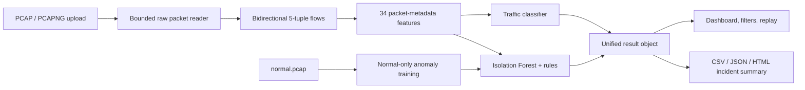

# Architecture

Signal / Flow turns a bounded PCAP or PCAPNG upload into bidirectional flow summaries. It reads link, IP, TCP/UDP, frame length, and timestamp metadata; it does not retain packet payloads or publish IP addresses and ports in the dashboard result.

## Request path

1. `src/app.py` validates the upload extension, in-memory size, request rate, and origin. Flask's body limit is slightly larger than the capture limit to allow multipart framing.
2. `src/pcap_reader.py` parses bounded raw frames. It supports common Ethernet/VLAN, Linux cooked, raw IP, and BSD loopback link types. Transport payload is neither dissected nor written. Processing stops at 100,000 packets and 25,000 flows.
3. `src/flows.py` groups TCP/UDP packets by a canonical bidirectional 5-tuple and records direction, frame length, and time. The 34 aggregate features are in `src/features.py`.
4. `src/pipeline.py` invokes the pre-trained traffic classifier and the independent anomaly engine, then returns a JSON-safe result without endpoint addresses or ports.
5. `src/anomaly.py` applies the normal-only Isolation Forest and capture-wide rules. All thresholds live in `config/anomaly.toml`.
6. `/analyze` returns JSON. `/replay` streams NDJSON flow events. `/export` creates CSV, JSON, and a printable HTML incident page. Analysis results are held in a bounded in-memory cache for up to 15 minutes; uploads are not persisted.

## Model integrity

`models/manifest.json` contains SHA-256 hashes for the executable joblib models. The app checks hashes before `joblib.load`. The hash manifest detects a missing or altered model file, but it is not a signed supply-chain attestation: an attacker able to replace both the model and manifest could replace the pair.

## Review workflow and privacy

Acknowledgements, dismissals, and notes are stored in browser `localStorage` under the analysis ID. They remain in that browser until cleared and are sent to the server only when the user requests an export. Uploads and parsed flow data stay in process memory. Public hosting displays a notice before upload; hosted use should be limited to the synthetic bundled samples.

## Async mode

Flask-SocketIO is configured for its `threading` backend. Eventlet is removed. The dashboard replay transport uses HTTP NDJSON streaming; the local-only optional sniffer is in `src/live_classify.py`.
