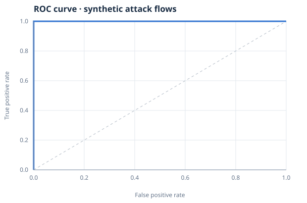
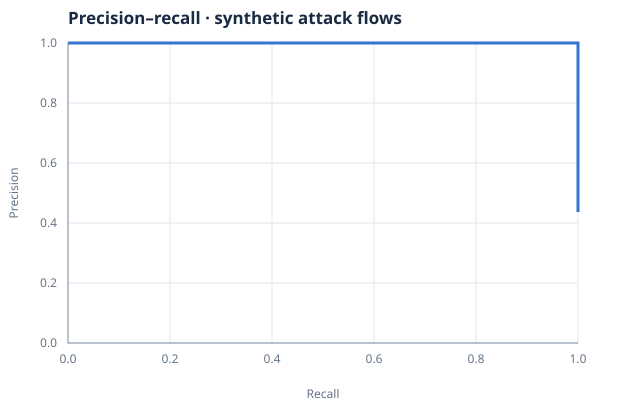
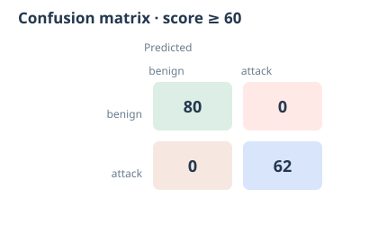

# Anomaly detector evaluation

Generated with `python scripts/evaluate_anomaly.py` using the bundled synthetic captures and separate truth labels.

## Results

At the high severity threshold (score ≥ 60), the detector found 62 of 62 injected attack flows (100.0% recall), with 0 false positives among 80 benign flows mixed into the attack capture. Precision was 100.0%; FPR was 0.0%. The separate 500-flow normal capture had a 0.4% medium-or-high false-positive rate (2 alerts).

| Measure | Result |
| --- | ---: |
| Detection rate / recall (score ≥ 60) | 100.0% |
| Precision (score ≥ 60) | 100.0% |
| False-positive rate (score ≥ 60) | 0.0% |
| ROC AUC | 1.000 |
| PR AUC (average precision) | 1.000 |
| Attack capture flows | 142 |
| Injected attack flows | 62 |

| Attack type | Flows | High severity detected | Matching rule | Mean score |
| --- | ---: | ---: | ---: | ---: |
| port scan | 26 | 26 (100.0%) | 26 (100.0%) | 98.0 |
| slow scan | 32 | 32 (100.0%) | 32 (100.0%) | 98.0 |
| exfiltration | 1 | 1 (100.0%) | 1 (100.0%) | 96.0 |
| dos burst | 1 | 1 (100.0%) | 1 (100.0%) | 92.0 |
| beaconing | 1 | 1 (100.0%) | 1 (100.0%) | 84.0 |
| dns tunnel | 1 | 1 (100.0%) | 1 (100.0%) | 90.0 |

## Method and limits

Metrics are flow-level. A score of 60 or higher is counted as a positive detection; 30–59 is medium severity. The scan rules use capture-wide source context, so each flow from a detected scan can be flagged. The sample PCAPs are generated by this project and the injected patterns are intentionally clear; synthetic attacks are easier to detect than real intrusion traffic. These results do not estimate real-world network performance. No public real-world capture was tested. Rules can miss evasive or distributed activity, and benign backups or unusual applications can trigger alerts. Review every alert in its network context.
