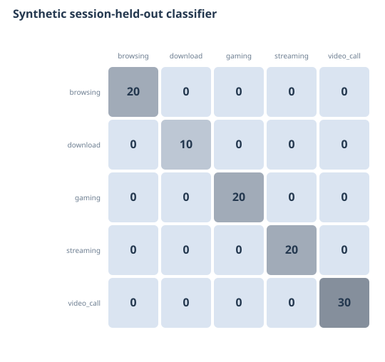

# Classifier session-held-out experiment

Generated with `python scripts/evaluate_classifier_sessions.py` from 500 generated normal flows across 50 synthetic sessions. Train, calibration, and test partitions contain disjoint session IDs (32, 8, and 10 sessions respectively).

| Candidate | Raw macro F1 | Calibrated macro F1 | Multiclass Brier ↓ | ECE ↓ | Review threshold | Test coverage | Selective accuracy |
| --- | ---: | ---: | ---: | ---: | ---: | ---: | ---: |
| RandomForestClassifier | 1.000 | 1.000 | 0.005 | 0.063 | 0.936 | 81.0% | 100.0% |
| HistGradientBoostingClassifier | 1.000 | 1.000 | 0.005 | 0.063 | 0.937 | 95.0% | 100.0% |

## Feature importance

Permutation importance is the decrease in macro F1 when one feature is shuffled in the held-out set.

| Feature | Macro F1 decrease |
| --- | ---: |
| packet_count | 0.0000 |
| duration | 0.0000 |
| total_bytes | 0.0000 |
| bytes_per_sec | 0.0000 |
| packets_per_sec | 0.0000 |
| up_packet_count | 0.0000 |
| down_packet_count | 0.0000 |
| up_down_packet_ratio | 0.0000 |
| up_bytes | 0.0000 |
| down_bytes | 0.0000 |

Every reported value is zero because held-out macro F1 is already saturated at 1.000; shuffling one feature does not lower the rounded score. This synthetic test cannot rank features meaningfully.

The alternative with the higher macro F1 on this synthetic split was **RandomForestClassifier**. Gradient boosting and class weighting were tested, and sigmoid probability calibration was fitted on separate synthetic calibration sessions. The review threshold is the tenth percentile of calibration-set maximum confidence (targeting roughly 90% coverage); coverage and accuracy are then measured on the untouched test sessions.

This experiment does not replace or retune the real-capture serving model. The generated classes have visible engineered differences, so this result cannot establish improvement on real encrypted traffic. The existing 1,554-row captured-flow dataset has no session IDs; its historical 62.7% accuracy and 0.632 macro F1 came from a random flow split. `capture.py` now records session IDs; rerun `python src/train.py` after collecting multiple independent sessions per class to produce a valid real session-held-out score.
