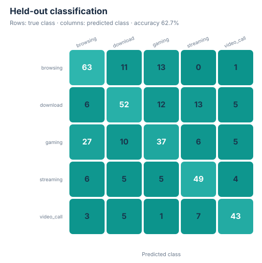

# Model evaluation

Generated by `python src/train.py` from the labeled aggregate features in `data/features.csv`.

| Measure | Result |
| --- | ---: |
| Accuracy | 62.7% |
| Macro F1 | 0.632 |
| Weighted F1 | 0.623 |
| Held-out flows | 389 |
| Split | Stratified 75% train / 25% test flow split, seed 42 |
| Whole sessions held out | No — session IDs were unavailable or insufficient |
| Training flows | 1165 |
| Test flows | 389 |

| Class | Dataset flows | Precision | Recall | F1 | Test flows |
| --- | ---: | ---: | ---: | ---: | ---: |
| browsing | 350 | 0.600 | 0.716 | 0.653 | 88 |
| download | 350 | 0.627 | 0.591 | 0.608 | 88 |
| gaming | 342 | 0.544 | 0.435 | 0.484 | 85 |
| streaming | 277 | 0.653 | 0.710 | 0.681 | 69 |
| video_call | 235 | 0.741 | 0.729 | 0.735 | 59 |

Rows are actual labels; columns are predictions. The source data lacks usable session IDs, so related flows may cross this random split. When whole-session holdout is unavailable, treat this as a baseline check, not an estimate of
performance on a new network or an independent capture. `capture.py` now writes session IDs for
new runs; grouped evaluation is selected automatically once there are enough separate sessions
with every class represented. After reporting the split, the serving model is fit on every row.
